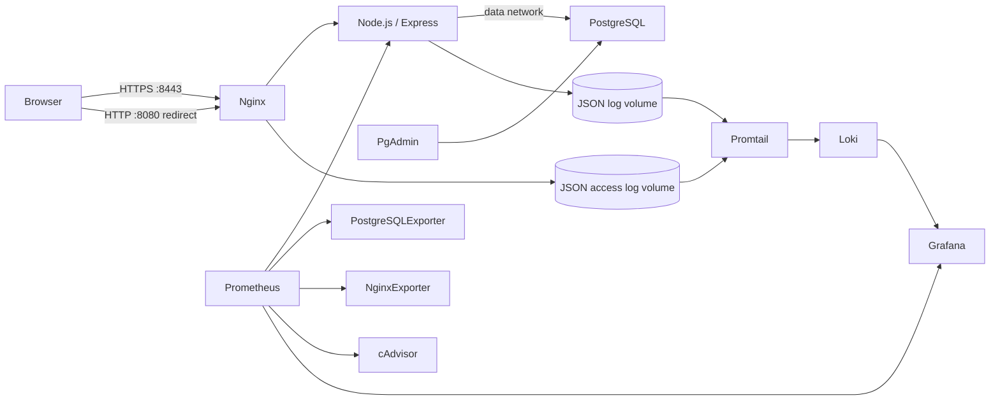

# Hệ thống quản lý thư viện Mộc

Ứng dụng quản lý sách, độc giả, mượn/trả; PostgreSQL + pgAdmin; Nginx reverse proxy; Prometheus/Grafana; Loki/Promtail. Tất cả dịch vụ được triển khai bằng Docker Compose.

## Kiến trúc



## Chạy local

Yêu cầu Docker Desktop ở chế độ Linux containers và Docker Compose v2. Website dùng chứng thư tự ký cho IP mạng nội bộ; trình duyệt sẽ cảnh báo rằng chứng thư chưa được tin cậy. IP Wi-Fi hiện tại của máy chạy dự án là `192.168.1.173`; nếu IP máy bạn khác, thay giá trị này bằng IPv4 trong kết quả `ipconfig`.

1. Tạo file môi trường: `Copy-Item .env.example .env`.
2. Sinh mật khẩu hex riêng biệt cho từng tài khoản. Trong PowerShell có thể dùng:

   ```powershell
   [Convert]::ToHexString([Security.Cryptography.RandomNumberGenerator]::GetBytes(32))
   ```

  Thay các placeholder trong `.env`. Mật khẩu quản trị web tối thiểu 8 ký tự; dùng mật khẩu dài, riêng biệt khi triển khai ngoài máy demo. Không commit `.env`.
3. Sinh chứng thư self-signed cho IP mạng nội bộ (cần Docker đang chạy). Nếu cần, sửa `$lanIp` thành IPv4 của máy chạy Docker. Khóa riêng nằm trong `certs/`, thư mục này đã được loại khỏi Git:

   ```powershell
   $lanIp = "192.168.1.173"
   New-Item -ItemType Directory -Force certs | Out-Null
   docker run --rm -v "${PWD}\certs:/certs" alpine:3.21 sh -c "apk add --no-cache openssl >/dev/null && openssl req -x509 -nodes -days 365 -newkey rsa:2048 -keyout /certs/web.key -out /certs/web.crt -subj '/CN=$lanIp' -addext 'subjectAltName=IP:$lanIp' && chmod 644 /certs/web.key"
   ```

   Khóa cần quyền đọc cho Nginx chạy non-root; chỉ dùng chứng thư này trong mạng nội bộ trên máy tin cậy, không tái sử dụng khi triển khai public.

4. Khởi động: `docker compose up -d --build`.
5. Kiểm tra: `docker compose ps` và `docker compose logs --tail=100 app nginx`.
6. Truy cập các địa chỉ sau:

| Dịch vụ | Địa chỉ | Tài khoản |
| --- | --- | --- |
| Website | https://192.168.1.173:8443 | `LIBRARY_ADMIN_EMAIL` / `LIBRARY_ADMIN_PASSWORD` |
| HTTP (tự chuyển sang HTTPS) | http://192.168.1.173:8080 | — |
| pgAdmin | http://localhost:5050 | `PGADMIN_DEFAULT_EMAIL` / `PGADMIN_DEFAULT_PASSWORD` |
| Prometheus | http://localhost:9090 | Chỉ bind vào localhost |
| Grafana | http://localhost:3000 | `GRAFANA_ADMIN_USER` / `GRAFANA_ADMIN_PASSWORD` |

Trong pgAdmin, đăng ký server với host `postgres`, port `5432`, database `library`, user `library_app`, và mật khẩu `LIBRARY_DB_PASSWORD`. Nếu pgAdmin yêu cầu master password thì đặt mật khẩu riêng, không dùng lại thông tin database.

Để thêm dữ liệu mẫu và chạy truy vấn, mở database `library` → **Tools → Query Tool**, mở file `db/pgadmin-demo-data.sql`, rồi chạy toàn bộ script. Script thêm sách, hồ sơ độc giả mẫu và lượt mượn gồm một lượt đang mượn, một lượt quá hạn và một lượt đã trả; có thể chạy lại mà không tạo bản trùng. `readers` là hồ sơ độc giả, không phải tài khoản đăng nhập. Các câu `SELECT` phía dưới hiển thị sách, độc giả, lượt mượn/quá hạn và thống kê thể loại.

Grafana có sẵn datasource Prometheus và Loki cùng dashboard **Library - Tổng quan hệ thống**. Để xem log: Explore → chọn Loki → chạy một trong các LogQL bên dưới. Chọn khoảng thời gian bao gồm lúc đã phát sinh request.

```logql
{job="library-app"}
{job="library-app", level="error"}
{job="nginx", status=~"4..|5.."}
```

Có thể sinh hoạt động thử để dashboard/log có dữ liệu: đăng nhập website, tạo một sách và độc giả, rồi tạo lượt mượn và nhận trả. Prometheus scrape mỗi 15 giây.

## Tính năng

- Đăng nhập quản trị, session lưu trong PostgreSQL, mật khẩu băm bcrypt, giới hạn đăng nhập.
- CRUD đầu sách và độc giả; tạo lượt mượn, nhận trả; cập nhật số bản được khóa trong transaction để tránh cho mượn quá số lượng.
- Tìm kiếm danh sách, trạng thái quá hạn, dashboard metrics và log JSON có nhãn.
- Dữ liệu PostgreSQL, pgAdmin, Prometheus, Grafana và Loki lưu trong Docker volumes.

## Hardening đã áp dụng

- Ứng dụng và Nginx chạy non-root; app chạy filesystem read-only, bỏ Linux capabilities, `no-new-privileges`.
- PostgreSQL chỉ dùng trong `data` network, không publish port ra host. Tài khoản ứng dụng riêng, không dùng superuser để truy cập dữ liệu.
- Tách network nội bộ `app_net`, `data`, `monitoring`; chỉ Nginx nhận traffic web. pgAdmin, Grafana, Prometheus chỉ bind `127.0.0.1`.
- Header X-Content-Type-Options, X-Frame-Options, CSP, Referrer-Policy, Permissions-Policy; tắt server token.
- Cookie HttpOnly/SameSite, kiểm tra header chống CSRF cho thay đổi dữ liệu, session rotation sau login, rate limit login.
- Query PostgreSQL có tham số, giới hạn JSON request 32 KB, health check, không đưa secrets vào Git.

Đây là cấu hình demo học tập trong mạng nội bộ, chưa thay thế quy trình production. Chứng thư tự ký không được trình duyệt tin cậy mặc định và IP có thể đổi theo DHCP; nên đặt DHCP reservation nếu cần địa chỉ ổn định. Nếu publish ra Internet, thay bằng chứng thư CA tin cậy (ví dụ Let's Encrypt) cho tên miền, quản lý secrets bằng secret store, xác thực dashboard/admin, phân quyền mạng chặt hơn và rà soát phiên bản image. pgAdmin/Prometheus/Grafana đang dành cho localhost.

## Các lệnh hữu ích

```powershell
docker compose up -d --build
docker compose ps
docker compose logs -f app nginx
docker compose down
docker compose down -v  # XÓA dữ liệu trong mọi named volume; chỉ chạy khi muốn reset
```

## GitHub và các mốc commit

Repository nguồn: https://github.com/Khai-KidTo/De-tai-1

Sau khi kiểm tra `.env` chưa được stage, có thể chia lịch sử theo 3 mốc yêu cầu:

1. `feat: add library app and nginx reverse proxy`
2. `feat: add prometheus grafana monitoring`
3. `feat: add loki logging and hardening report`

Commit và push là thao tác riêng; không đưa file `.env`, mật khẩu, hoặc dữ liệu thật lên GitHub.

## Báo cáo và minh chứng

Mẫu báo cáo 10 phần ở [docs/report.md](docs/report.md). Điền thông tin sinh viên, chụp màn hình hệ thống thật vào `screenshots/`, rồi đưa ảnh vào các vị trí đánh dấu trước khi nộp. Ảnh chưa được tạo tự động vì phụ thuộc môi trường Docker sau khi bạn chạy stack.

## Lưu ý

- PostgreSQL init script chỉ chạy khi volume dữ liệu được tạo lần đầu. Thay đổi mật khẩu init sau đó không cập nhật role đã tồn tại.
- cAdvisor cần Docker Desktop/daemon hỗ trợ mount các đường dẫn host đã cấu hình; kiểm tra target `containers` trên Prometheus nếu dùng môi trường không phải Linux.
- Dashboard và endpoint metrics chỉ dành cho môi trường demo nội bộ.
