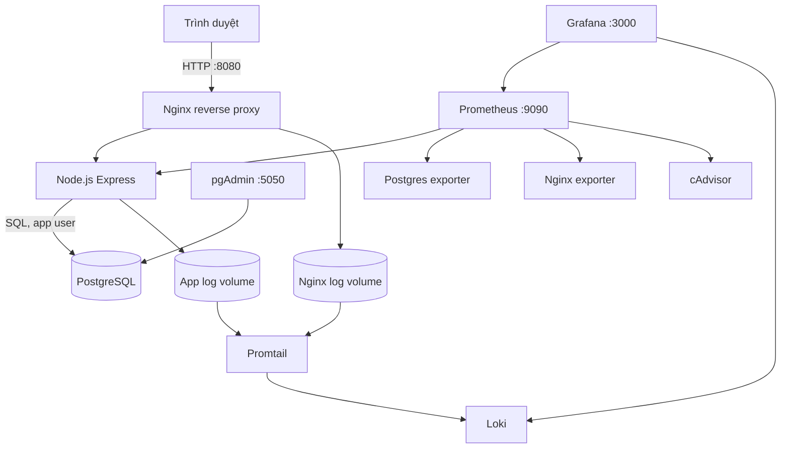

# BÁO CÁO ĐỀ TÀI: HỆ THỐNG QUẢN LÝ THƯ VIỆN

> Mẫu báo cáo gồm 10 trang/10 phần nội dung. Điền các trường trong ngoặc vuông, chuyển mỗi `\newpage` thành ngắt trang trong Word/LibreOffice nếu cần, bổ sung ảnh chụp thật từ thư mục `screenshots/`, và cập nhật ngày/phiên bản trước khi nộp.

## Trang 1. Bìa báo cáo

**[TÊN TRƯỜNG / KHOA / BỘ MÔN]**

**BÁO CÁO ĐỀ TÀI HỌC PHẦN / THỰC TẬP**

### XÂY DỰNG HỆ THỐNG QUẢN LÝ THƯ VIỆN
### VỚI DOCKER COMPOSE, POSTGRESQL VÀ GIÁM SÁT TẬP TRUNG

**Đề tài:** Đề 1 - Hệ thống Quản lý Thư viện  
**Sinh viên:** [Họ và tên]  
**Mã số sinh viên:** [Mã số sinh viên]  
**Lớp:** [Tên lớp]  
**Giảng viên hướng dẫn:** [Họ tên giảng viên]  
**Đơn vị thực tập / học phần:** [Tên đơn vị]

**[Địa danh], [tháng/năm]**

\newpage

## Trang 2. Lời mở đầu và mục tiêu

Thư viện cần theo dõi đầu sách, số bản có thể cho mượn, bạn đọc và lịch sử giao dịch. Khi các dữ liệu này được ghi chép rời rạc, người quản lý khó biết một đầu sách còn bao nhiêu bản, lượt nào sắp quá hạn, hoặc lịch sử mượn trả của một độc giả. Đề tài xây dựng một ứng dụng web nhỏ để số hóa các thao tác đó, đồng thời triển khai toàn bộ ứng dụng và công cụ vận hành bằng Docker Compose.

Mục tiêu chính là tạo một hệ thống có thể chạy lại trên máy khác từ mã nguồn và cấu hình. Website cung cấp đăng nhập quản trị, quản lý sách và độc giả, tạo lượt mượn, nhận trả và cập nhật số lượng bản còn lại. PostgreSQL lưu dữ liệu quan hệ; pgAdmin hỗ trợ quan sát và thao tác quản trị cơ sở dữ liệu. Nginx làm reverse proxy, thêm security headers và ghi access log có cấu trúc. Prometheus thu thập metrics, Grafana trình bày dashboard, Loki nhận log qua Promtail.

Phạm vi là bản demo học tập chạy local, không xử lý nghiệp vụ tiền phạt, đặt chỗ, nhiều chi nhánh hoặc phân quyền nhiều cấp. Không sử dụng dữ liệu cá nhân thật trong demo. Các mật khẩu đặt trong `.env` là mật khẩu mẫu tại máy chạy và không được đưa lên repository.

Kết quả cần minh chứng gồm: website hoạt động; kết nối pgAdmin tới PostgreSQL; Nginx phục vụ website và trả header bảo mật; Prometheus báo target đang scrape; dashboard Grafana có số liệu; Loki truy vấn được ít nhất ba loại log; cấu hình container/network giảm quyền; và repository có README chạy lại được.

\newpage

## Trang 3. Yêu cầu và thiết kế tổng thể

### Yêu cầu chức năng

1. Quản trị viên đăng nhập và đăng xuất bằng tài khoản cấu hình qua biến môi trường.
2. Tạo, xem, cập nhật và xóa hồ sơ sách; ISBN là duy nhất nếu được nhập.
3. Tạo, xem, cập nhật và xóa hồ sơ độc giả; email là duy nhất.
4. Tạo lượt mượn nếu sách còn bản; mặc định hạn trả sau 14 ngày.
5. Nhận trả lượt mượn đang mở; số lượng có sẵn được hoàn lại đúng một bản.
6. Tìm kiếm trong danh sách, xem trạng thái quá hạn và thống kê cơ bản.

### Yêu cầu phi chức năng

Ứng dụng và dịch vụ có thể dựng bằng Docker Compose; dữ liệu bền vững qua named volumes. Cấu hình nguồn nằm trong Git, bí mật runtime nằm trong file `.env` bị ignore. Mạng database không publish ra host. Web được reverse proxy qua Nginx. Các thành phần có metrics/log để hỗ trợ demo và chẩn đoán.

### Sơ đồ thành phần



Nginx, ứng dụng và database được nối bằng các network Compose có mục đích riêng. Port PostgreSQL không mở lên máy host; các giao diện vận hành được bind trên loopback để không công khai trong mạng LAN theo mặc định.

\newpage

## Trang 4. Công nghệ và cấu trúc mã nguồn

Backend dùng Node.js 22, Express và thư viện `pg`. Giao diện dùng HTML, CSS và JavaScript phía trình duyệt để giảm số thành phần cần build. PostgreSQL 17 lưu bảng administrators, books, readers, loans và bảng session do connect-pg-simple quản lý. pgAdmin cung cấp công cụ DB. Nginx dùng image unprivileged. Prometheus lấy dữ liệu từ endpoint app `/metrics`, Postgres exporter, Nginx exporter và cAdvisor. Grafana được provision sẵn datasource và dashboard. Promtail đọc log JSON từ các named volumes và gửi sang Loki.

```text
.
|-- docker-compose.yml
|-- Dockerfile
|-- package.json
|-- .env.example
|-- src/server.js
|-- public/index.html, app.js, styles.css
|-- db/init/01-create-app-user.sh
|-- nginx/nginx.conf
|-- prometheus/prometheus.yml
|-- grafana/provisioning/
|-- grafana/dashboards/library-overview.json
|-- loki/loki-config.yml
|-- promtail/promtail-config.yml
|-- docs/report.md
|-- screenshots/
`-- README.md
```

Compose định nghĩa các service và quan hệ `depends_on` theo trạng thái health của PostgreSQL. Volume riêng bảo toàn dữ liệu cho PostgreSQL, pgAdmin, Prometheus, Loki, Grafana và log. `logs-init` chuẩn bị quyền thư mục log để các container non-root có thể ghi/đọc đúng phạm vi.

**[Hình 1: Chụp `docker compose ps` sau khi toàn bộ service đã chạy ổn định.]**  
Lưu ảnh tại `screenshots/01-compose-ps.png`.

**[Hình 2: Sơ đồ kiến trúc được render từ Mermaid hoặc vẽ lại theo sơ đồ ở trang 3.]**  
Lưu ảnh tại `screenshots/02-architecture.png`.

\newpage

## Trang 5. Cơ sở dữ liệu và nghiệp vụ

Các bảng chính có quan hệ như sau:

| Bảng | Nội dung | Ràng buộc tiêu biểu |
| --- | --- | --- |
| administrators | Tài khoản quản trị | email unique, password_hash |
| books | Đầu sách và số bản | ISBN unique; tổng bản > 0; bản có sẵn nằm trong khoảng hợp lệ |
| readers | Bạn đọc | email unique |
| loans | Giao dịch mượn trả | foreign key đến books/readers; trạng thái borrowed/returned |
| session | Phiên đăng nhập | được thư viện session store tạo trong PostgreSQL |

Khi tạo một lượt mượn, ứng dụng mở transaction, khóa dòng sách bằng `SELECT ... FOR UPDATE`, kiểm tra số bản có sẵn, giảm số lượng và tạo lượt mượn trước khi commit. Nếu một thao tác thất bại, transaction rollback. Khóa dòng giúp hai yêu cầu đồng thời không thể cùng mượn vượt số bản tồn. Khi nhận trả, ứng dụng khóa giao dịch, chỉ nhận trả nếu trạng thái còn borrowed, đánh dấu thời điểm trả và tăng bản có sẵn trong cùng transaction.

Các câu truy vấn động dùng placeholder `$1`, `$2` thay vì ghép dữ liệu người dùng vào SQL. Ràng buộc unique và foreign key ở database bổ sung lớp bảo vệ khi có lỗi từ ứng dụng. Tài khoản `library_app` riêng không dùng superuser `postgres`; tài khoản ứng dụng chỉ được dùng trong mạng data.

pgAdmin kết nối bằng hostname nội bộ `postgres`, không phải `localhost` trong container pgAdmin. Database là `library`, port nội bộ 5432, user ứng dụng `library_app`. `postgres` chỉ dành cho tác vụ quản trị cần thiết và exporter trong cấu hình demo; không dùng tài khoản này trong app.

**[Hình 3: Chụp pgAdmin hiển thị server đã kết nối và các bảng books/readers/loans.]**  
Lưu ảnh tại `screenshots/03-pgadmin-schema.png`.

\newpage

## Trang 6. Reverse proxy và hardening

Nginx nhận yêu cầu tại cổng 8080 và chuyển tiếp đến service `app:3000` qua `app_net`. Ứng dụng không publish port trực tiếp. Nginx chuyển tiếp thông tin host, địa chỉ client và scheme bằng các header `X-Forwarded-*`. Endpoint metrics không được công khai qua proxy; exporter đọc trang trạng thái Nginx trên listener riêng trong mạng Compose.

Các header gồm X-Content-Type-Options `nosniff`, X-Frame-Options `DENY`, Referrer-Policy, Permissions-Policy và Content-Security-Policy. Nginx tắt server token, giới hạn kích thước body 32 KB và cấu hình timeout. Bản demo chọn HTTP cùng security headers để dễ chạy local; khi cần minh chứng HTTPS có thể thêm chứng thư tự ký và listener TLS, trình duyệt sẽ cảnh báo chứng thư chưa được tin cậy.

Biện pháp giảm quyền đang có trong Compose:

- Node.js dùng `USER node`, Nginx dùng image unprivileged; không tiến trình nào cần quyền root ở runtime.
- Ứng dụng và Nginx dùng filesystem read-only, tmpfs chỉ dành cho dữ liệu tạm cần thiết.
- `cap_drop: ALL` và `no-new-privileges` trên các dịch vụ hỗ trợ.
- Các mạng `app_net`, `data`, `monitoring` được đặt internal; PostgreSQL không có `ports`.
- pgAdmin, Prometheus và Grafana chỉ bind `127.0.0.1` theo mặc định.
- Mật khẩu cấu hình từ `.env`; `.env` nằm trong `.gitignore`; tài khoản app riêng và dữ liệu SQL có tham số.
- Mật khẩu quản trị tối thiểu 16 ký tự, hash bcrypt cost 12; session cookie HttpOnly/SameSite và rate limit login.

Các hạn chế: đây là cấu hình demo, exporter PostgreSQL dùng tài khoản quản trị để thu thập metrics. Hệ thống production nên có tài khoản exporter quyền đọc chuyên biệt, secret manager, TLS, cập nhật image định kỳ, backup/restore, log retention có kiểm soát và kiểm thử bảo mật độc lập.

**[Hình 4: Chụp DevTools Network/Response Headers xác nhận header từ Nginx.]**  
Lưu ảnh tại `screenshots/04-security-headers.png`.

\newpage

## Trang 7. Prometheus và Grafana

Prometheus dùng chu kỳ scrape 15 giây. Các job trong `prometheus/prometheus.yml` gồm Prometheus tự giám sát, web app, PostgreSQL exporter, Nginx exporter và cAdvisor. Ứng dụng xuất metric HTTP request count theo method/route/status và histogram latency. Prometheus lưu time series trong volume, với retention cấu hình 15 ngày.

Grafana được provision datasource Prometheus và Loki từ YAML. Dashboard Library Overview hiển thị tốc độ request, tổng lỗi máy chủ theo giờ, latency p95, CPU và memory theo container. Các truy vấn dashboard sử dụng PromQL và Prometheus UID ổn định. Dashboard JSON được lưu trong Git nên có thể khôi phục khi tái tạo Grafana.

Quy trình kiểm tra: mở Prometheus → Status → Targets; xác nhận các job trạng thái `UP`. Truy vấn `up` để nhìn toàn bộ scrape target. Trong Grafana, mở dashboard Library - Tổng quan hệ thống; tạo các thao tác trên website để sinh request và quan sát biểu đồ. Nếu dữ liệu container trống, kiểm tra cAdvisor và mức hỗ trợ mount host của Docker Desktop.

**[Hình 5: Prometheus Targets cho thấy app, postgres exporter, nginx exporter và cAdvisor đang UP.]**  
Lưu ảnh tại `screenshots/05-prometheus-targets.png`.

**[Hình 6: Dashboard Grafana có dữ liệu request, latency và container.]**  
Lưu ảnh tại `screenshots/06-grafana-dashboard.png`.

\newpage

## Trang 8. Loki, Promtail và LogQL

Ứng dụng ghi mỗi sự kiện thành một JSON line với thời gian UTC, level và event. Đồng thời log được ghi stdout để `docker compose logs` tiếp cận được và ghi vào named volume dùng chung với Promtail. Nginx ghi access log JSON vào volume khác. Promtail đọc hai volume chỉ đọc, trích các trường JSON và gắn các nhãn phù hợp trước khi gửi đến Loki. Loki lưu chỉ mục và chunk trên volume, retention demo đặt 7 ngày.

Các truy vấn LogQL mẫu:

```logql
{job="library-app"}
```

Truy vấn trên lấy mọi log ứng dụng. Lọc sự kiện lỗi:

```logql
{job="library-app", level="error"}
```

Lọc request Nginx có lỗi client hoặc server:

```logql
{job="nginx", status=~"4..|5.."}
```

Đếm HTTP 5xx trong mỗi phút:

```logql
sum by (status) (count_over_time({job="nginx", status=~"5.."}[1m]))
```

Mở Grafana Explore, chọn Loki, đặt time range phù hợp và chạy truy vấn. Để tạo dữ liệu 4xx/5xx có kiểm soát, gọi một URL không tồn tại hoặc dùng endpoint không hợp lệ trong môi trường demo. Không chủ động tạo lỗi trên hệ thống thật.

**[Hình 7: Grafana Explore hiển thị kết quả query `{job="library-app"}`.]**  
Lưu ảnh tại `screenshots/07-logql-app.png`.

**[Hình 8: Grafana Explore hiển thị query lọc lỗi hoặc Nginx 4xx/5xx.]**  
Lưu ảnh tại `screenshots/08-logql-errors.png`.

\newpage

## Trang 9. Quy trình triển khai và kiểm thử

### Dựng hệ thống

1. Clone repository và tạo `.env` từ `.env.example`.
2. Sinh giá trị ngẫu nhiên riêng cho từng mật khẩu, thay toàn bộ placeholder và không chia sẻ file môi trường.
3. Chạy `docker compose config` để kiểm tra cấu hình, sau đó `docker compose up -d --build`.
4. Chờ health check PostgreSQL; kiểm tra `docker compose ps` và logs app.
5. Đăng nhập website, tạo đầu sách, tạo độc giả, tạo lượt mượn, rồi nhận trả.
6. Kết nối pgAdmin, kiểm tra bảng và cập nhật số bản.
7. Kiểm tra Prometheus Targets, mở dashboard Grafana và chạy truy vấn Loki.

### Ma trận kiểm thử demo

| Kiểm thử | Kết quả mong đợi | Bằng chứng |
| --- | --- | --- |
| Mở website qua Nginx | Giao diện đăng nhập trả HTTP 200 | Ảnh trình duyệt |
| Đăng nhập đúng/sai | Đúng vào màn hình quản lý; sai trả thông báo chung | Ảnh login |
| Tạo sách/độc giả | Bản ghi hiển thị trong danh sách và pgAdmin | Ảnh app + pgAdmin |
| Mượn sách cuối cùng | Số bản có sẵn giảm về 0; lượt mượn được tạo | Ảnh danh sách mượn |
| Mượn khi hết sách | API từ chối, dữ liệu không âm | Ảnh thông báo |
| Trả sách | Trạng thái returned, số bản có sẵn tăng một | Ảnh app + DB |
| Truy cập endpoint metrics qua Nginx | Bị chặn; Prometheus vẫn scrape app nội bộ | Ảnh response/Targets |
| Truy vấn Loki | Log app và access log có kết quả | Ảnh Explore |
| Kiểm tra hardening | Không có port DB; container app chạy user node | `docker compose ps`, `docker compose exec app id` |

Ghi lại ngày chạy, phiên bản Docker Desktop, commit ID và mọi sai khác môi trường. Ảnh minh chứng cần thể hiện dữ liệu do người làm tạo trong lần demo, tránh dùng ảnh giả lập.

\newpage

## Trang 10. Kết luận, hạn chế và hướng phát triển

Đề tài đã xây dựng một đường triển khai nhất quán cho ứng dụng quản lý thư viện. Các thành phần có cấu hình khai báo: Node.js/Express xử lý nghiệp vụ; PostgreSQL lưu trữ; pgAdmin hỗ trợ quản trị; Nginx tiếp nhận web; Prometheus/Grafana theo dõi metrics; Loki/Promtail tập trung log. Docker Compose cùng named volumes hỗ trợ dựng lại và lưu dữ liệu. Các biện pháp như non-root, giới hạn network, header bảo mật, session cookie, rate limit và secrets ngoài Git giảm một số rủi ro thường gặp trong ứng dụng demo.

Kiểm thử nghiệp vụ tập trung vào tính nhất quán số lượng bản trong luồng mượn/trả. Dữ liệu giao dịch thay đổi trong transaction; thao tác mượn khóa dòng sách trước khi giảm tồn kho. Cấu hình observability cung cấp tín hiệu cơ bản để theo dõi yêu cầu, lỗi, độ trễ và log request. Dashboard và LogQL được quản lý bằng file cấu hình trong repository, không cần thao tác cấu hình thủ công sau mỗi lần tạo mới.

Hạn chế hiện tại gồm chưa có nhiều vai trò người dùng, không có quy trình backup tự động, chưa có TLS mặc định, chưa có migration framework, chưa có kiểm thử tự động toàn diện và một số dịch vụ giám sát chỉ phù hợp môi trường local. cAdvisor có thể phụ thuộc hệ điều hành Docker host. pgAdmin và dashboard không nên expose công khai nếu chưa được bảo vệ bổ sung.

Hướng phát triển: bổ sung kiểm thử API và kiểm thử end-to-end; migration versioned; backup/restore định kỳ; tài khoản PostgreSQL exporter read-only; HTTPS với certificate phù hợp; xác thực và phân quyền theo vai trò; cảnh báo Prometheus; retention và giới hạn dung lượng Loki; CI kiểm tra Compose, syntax và dependency; quy trình cập nhật image và rà soát lỗ hổng.

### Tài liệu tham khảo

- Docker Compose: https://docs.docker.com/compose/
- PostgreSQL: https://www.postgresql.org/docs/
- Prometheus: https://prometheus.io/docs/
- Grafana Loki và LogQL: https://grafana.com/docs/loki/latest/
- Nginx: https://nginx.org/en/docs/
- Express: https://expressjs.com/

**Xác nhận sinh viên:** [Họ và tên, ngày tháng]  
**Nhận xét giảng viên:** [Dành cho giảng viên]
